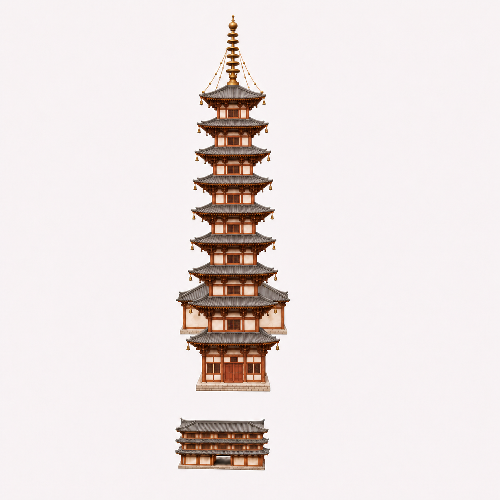

# 永宁寺塔 V4：参考现存早期佛塔的形制改定

2026-11-26，Asia/Shanghai。用户要求：参考日本法隆寺的塔和国内时代接近的塔实体图，改定当前塔图。

**本轮选用第三次生成结果作为形制改定稿。** 九层木塔、三层南门仍可辨；塔的出檐、层间木构、门窗与塔刹已重绘。它是有来源说明的比较复原方案，尚未通过全部基址几何，不作为已经完成考古复原的立面，也未进入全景回嵌或替换首页。

## 本次实际改了什么

| 部位 | 原V3的图面表现 | 本次V4的图面变化与依据 |
| --- | --- | --- |
| 屋面与出檐 | 较窄的屋面重复叠置，墙身显得细长 | 参照法隆寺实物的深出檐与缓坡，增强檐下阴影、瓦面厚度和承托层次；不照抄其五重数量、裳阶或具体尺寸 |
| 塔身层次 | 大块浅色空墙和重复柱框 | 改成有凹入门窗、深浅木骨与小块壁面的楼层；每个楼层均保留可辨墙身，不以密檐凑九层 |
| 收分与整体感 | 九个近似重复模块，承托感弱 | 屋面和轴部逐层收束，底层门面更明确；嵩岳寺仅提供连续收分及水平节奏的类型对照 |
| 塔刹 | 近似一根光杆 | 改为金属盘、顶部宝瓶示意、细链及檐角悬铎；主要依据永宁寺自身文本，盘数、链长及饰件尺寸不是实测复原 |
| 基址与关系 | 沿用冻结来源平面，但V3本身仍有小幅图像残差 | 前两次生成造成明显放大，第三次将塔座基本收回原尺度；后殿仍有位置及体量残差，详见审查记录 |

上述为对生成结果的观察和设计判断。绘图所选的斗栱细部、各层窗格、色彩、层高及收分比例仍是表现方案，不能因参考实物而升级成北魏永宁寺的已证细节。尤其不宣称画面已经逐窗、逐门、逐铎复现所有文献数量。

## 实际使用的三项实体照片

| 参考对象 | 时间及材料 | 用途与边界 |
| --- | --- | --- |
| [法隆寺五重塔：文化厅条目](https://kunishitei.bunka.go.jp/bsys/maindetails/102/2683) | 现存塔推定7世纪末；木构，主体五重，初重附裳阶 | 木构支承、深出檐、缓坡、轴部收分的较晚实物对照。不能把心柱材594年的伐采年当作现存塔落成年，也不把附属檐计为第六主体层 |
| [北魏嵩岳寺塔：郑州市文物局](https://wwj.zhengzhou.gov.cn/country/3174965.jhtml) | 北魏时期；十二边形密檐砖塔。公开介绍有509、520年代、523等不同记年 | 对照整体收分与水平节奏。不能将十五道砖檐、十二边砖筒或现存经修葺塔刹移植到永宁寺方形九层木塔 |
| [神通寺四门塔：山东广电实拍](https://wurenji.iqilu.com/kxw/2017/1025/3723204.shtml) | 隋大业七年611；方形单层石塔 | 对照简练的早期体量、檐缘与刹座层次。石叠涩结构和单层石室不能作为永宁寺九层木构的结构证据 |

首轮生成器确实接收并参考了三张实体照片，而非只输入建筑名称。照片的实际URL、作者、像素、校验值及用途记录在[sources.json](sources.json)。照片在本地目读后使用，本目录不转载无明确开放许可的实物照片原件。嵩岳寺实拍署名Windmemories，2025-11-01，CC BY-SA 4.0，来源为[该照片页](https://commons.wikimedia.org/wiki/File:20251101_Pagoda_of_Songyue_Temple_01.jpg)。

永宁寺的九层、木构、门窗、金刹、悬铎及塔北佛殿关系，仍回到[《洛阳伽蓝记》卷一永宁寺条](https://zh.wikisource.org/zh-hans/%E6%B4%9B%E9%99%BD%E4%BC%BD%E8%97%8D%E8%A8%98/%E5%8D%B7%E4%B8%80)。本轮未解决不同传本的金盘等数字异文，也没有据照片计算永宁寺的真实层高。

## 生成过程与文件

全部采用内置imagegen图像编辑，未用代码修改图像像素。选中原PNG只作逐字节复制。

1. [第一稿](yongning-v4-attempt1.png)：V3原图加三张实体照片，形制改善明确，但塔座与后殿被明显放大。保留为过程记录，未选用。实际提示为[prompt-v4.txt](prompt-v4.txt)。
2. [第二稿](yongning-v4-attempt2.png)：针对放大问题修正，仍未恢复到原基址尺度。保留为过程记录，未选用。实际提示为[prompt-v4-attempt2.txt](prompt-v4-attempt2.txt)。
3. **[选用稿](yongning-built-reference-v4.png)**：重新以V3为编辑目标，以第二稿为建筑语言参考，配合既有冻结地面导引。塔座大幅漂移已收回，保留新形制。实际提示为[prompt-v4-attempt3.txt](prompt-v4-attempt3.txt)。

三次均为同一永宁寺局部形制修改，不是三次新的全城全景尝试。原V3、已发布三图及V14六次拒用记录均保留。

## 审查与当前状态

- [独立视觉审查](visual-review.md)与[结构化审查](visual-review.json)：按墙身／柱列／开口区计层，区分形制改善、主要尺度恢复和剩余位置偏差。
- [生成与输入身份](generation.json)：每次输入角色、原图身份、尺寸、SHA-256及提示文件。
- [参考材料说明](reference-notes.md)：哪些观察可以迁移，哪些属于材质、时代和类型差异。
- [文件清单](inventory.json)：本目录全部交付文件的字节数、SHA-256及Git blob标识；清单不循环记录自身。

选用PNG为1254×1254，SHA-256：`79bd1f46cedfdf4b517aaea592da499744e42992d2860affb3146ca554a3acd6`。

冻结的`projection.json`、H、来源轮廓及已有上部显示参数文件均未改写。本次新上部形制是独立艺术候选，没有冒充旧显示参数的确定性渲染。后殿基脚仍与V3及冻结环有偏差；V3已有的几何未通过项也不因本次外观改善自动消除。

`visible_storeys_passed=true`；`architectural_form_revision_selected=true`；`whole_ground_geometry_passed=false`；`ready_for_reintegration=false`；`new_panorama_generated=false`；`homepage_replacement_approved=false`；`site_images_replaced=false`。

正式站仍为生产提交`bbfbac9022e133e61836614f3b120cf42efde43e`的三图专题，首页仍为已批准V12。本次完成的是用户要求的实体照片参照与形制改定，并保存可继续审查的候选；不宣称该候选已上线或已完成全景替换。

下一步以本选用稿的塔身语言继续，先校后殿和剩余基脚，再独立审查全景回嵌中的九层／三层、寺墙端点及框外变化。不要从第一、二稿的大底座继续，也不要改动来源H来迁就图像。
