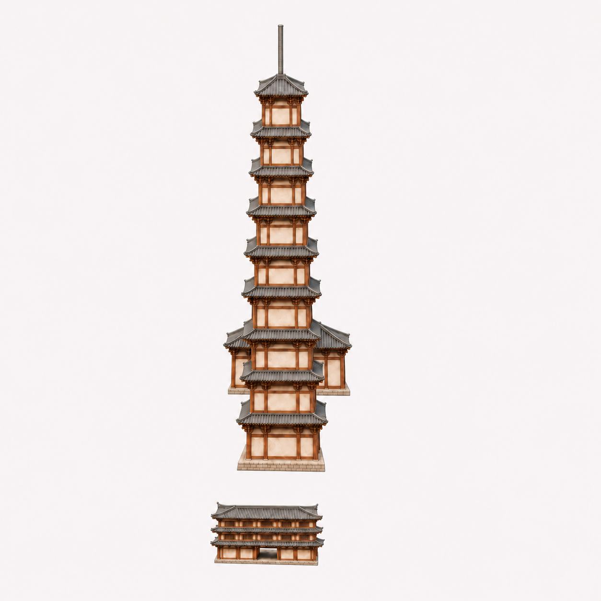

# 永宁寺局部 V3：2026-11-25 修正与未通过检查点

本次从 11 月 24 日已发布的局部 V2 继续，只编辑塔座、南门和后殿可见基脚。保留原 PNG、实际提示、输入身份、26 项新读数、逐边／角点状态和分析叠加，供下一会话直接续接。

**局部图仍未通过完整几何验收，暂不回嵌。** 九层塔、三层南门可辨；南门前缘改善约 4.5–6 像素，但仍低约 5–8 像素。塔座西南角接近，东南角却过宽；后殿左前角仍错位。小数差值仅为算术结果，手读边缘约有 ±2 像素不确定度，不是考古测量精度。

## 原件与审查

- [逐项审查与下一修正目标](correction-review.md)
- [原始审查 JSON](audit-v3.json)
- [冻结轮廓与实见边叠照](audit-v3-overlay.svg)
- [实际提示](prompt-v3.txt)与[来源身份](source.json)
- 三张 `*-readonly-ruler.png` 为原像素的分析放大视口，不改动原 PNG。

内置 imagegen 的编辑目标为生产提交 `bbfbac9022e133e61836614f3b120cf42efde43e` 的 `corrected-local.png`。第二输入沿用冻结洋红轮廓导引，其底层旧画稿不是编辑目标。没有改变冻结 H、来源轮廓或按单体拟合。

新图 SHA-256：`820b276856b72f25f42a868c5c75cafde037ea9d766fd51f40e8921c5c228e06`，1254×1254。本图为第三次局部修正，并非新全景；`ready_for_reintegration=false`、`full_panorama_accepted=false`、`homepage_replacement_approved=false`。实际网站仍为 11 月 24 日三图及已批准 V12 首页。

下一次按本图实际读数修正塔座东南角、南门非均匀前缘和后殿左前角；保留已接近的西南角与可辨层数。七段实体寺墙没有绘出，墙端未核；不可把留白中的未吻合来源角点全部归作遮挡。新的局部通过后，全景回嵌仍需独立审查。

