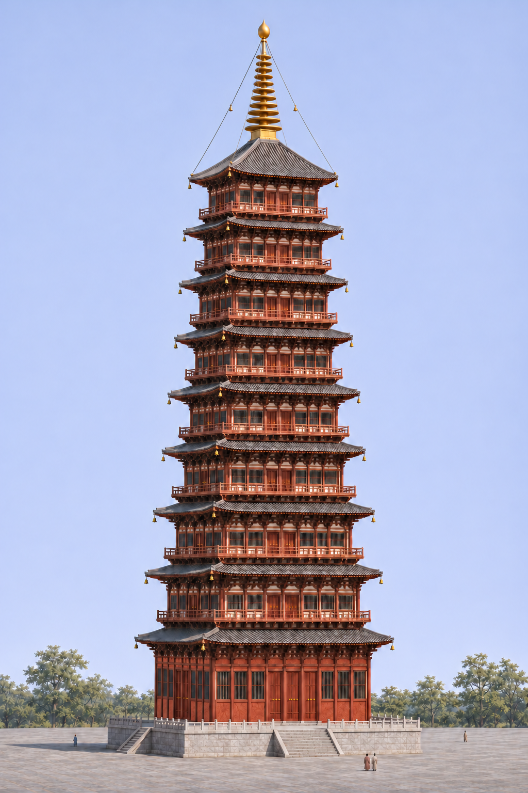
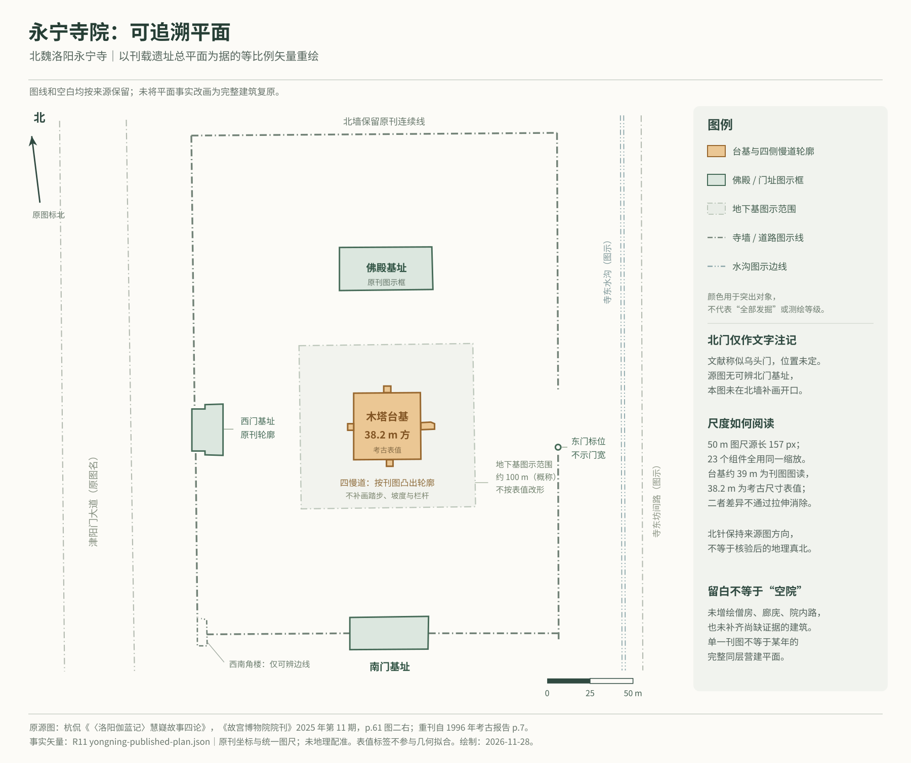

# 永宁寺复原图谱、文献对读与 V5 工作复原

2026-11-28｜历史研究项目｜研究对象：北魏洛阳永宁寺及其九层塔

## 我的判断

我建议将永宁寺塔复原为**方形九层、以木构楼阁为外观、内部保留土坯塔心问题的巨型佛塔**：初层多开间，朱漆门扇与朱色外墙，上层有可辨的平坐及栏杆，塔体向上内收，顶部设金盘、宝瓶及四角铁索。下部层间递减，顶层墙身和完整屋顶另行分配。

本案采用**含塔刹约147米**的工作高度。这个数值是一组明确公开的绘图假设，**不是新考定的原高**。我倾向于钟晓青、王贵祥等研究所表达的楼阁木塔方向；具体层高、上层开间、塔心终止层、斗栱细部仍不可能由现有资料唯一决定。[S1][S2][S3]

完成的图有三种用途：

- [全塔概念效果图](yongning-v5-concept.png)：观看体量、材质及层间关系。最终图可辨九层、八道上层平坐、十一重金盘；侧面门窗仍有渲染简化。
- [立面参数图](our-elevation.png)／[可编辑SVG](our-elevation.svg)：本案九层、高度标高与选择理由；尺寸以这里和 [参数JSON](design-parameters.json) 为准。
- [寺院平面图](our-temple-plan.png)／[可编辑SVG](our-temple-plan.svg)：从已刊考古图的23个组件等比例重绘，不补造未知建筑。

**图像说明：**这是一张现代研究构想的生成效果图。正面初层三门六窗可读，左斜面开口仍未精确复现同样数量；透视画面没有测量标定，不能据人物或像素比例证明塔高147米。立面图给出的是准确绘制的假设参数，也不等于原建筑的精确测绘。

## 一、网上的复原图实际分成哪些来源

本次检索覆盖中、英、日文公开网页，追查学者论文与图号、期刊及博物馆官网、机构数字项目、带原始署名的科普图和现场模型照片。多个转载站的同图合并记录。下面列的是目前可追溯的代表图谱，不以网页数量充当独立研究数量，也不声称穷尽所有未开放论文和私人图档。

### 1. 学术方案与高度意见

| 方案或图像 | 已核到的身份 | 高度口径 | 我如何使用 |
|---|---|---|---|
| 杨鸿勋，1992及后续增订 | 王贵祥2022文所转载的剖面图可辨；本次未取得杨1992原刊全文 | 据张庆捷2021转引，约147米含刹 | 重视其将遗址与建筑形态结合的尝试；首层比例和高位土心保留讨论 |
| 钟晓青，1998 | 王文图6所转载的立面与剖面合图 | 据张庆捷转引，含刹约150米；网上133.6米不能直接当成同一口径的总高 | 多开间、平坐及木构外观更接近本案选择；不照搬其土心全高 |
| 王贵祥，2013 | 作者2022回顾中的图10、11；“七”是比例模数 | 56丈，约153米 | 参考其连续楼阁构成；比例推演本身仍是假说 |
| 王贵祥，2022 | 作者署名论文图16、17、20、21 | 56.2丈，约153.31米 | 比较其修订后的收分；“九”的象征关系不作为尺寸已证的依据 |
| 张驭寰数据／陈随、星球研究所2020重绘 | 原发布页及图内明确写数据来源与绘图者 | 科普图标约110米 | 纳入较低方案；不能把科普重绘冒称张氏原论文原图 |
| 钱国祥，2017 | 发掘主持者的塔基、塔心及比较研究图 | 正文另将49丈解释为约133米，塔身约100米 | 主要采用其遗迹与柱网资料；其高度解释与本案不同，明确并列 |
| 陈明达的高度意见 | 王贵祥回顾所转引；本次未取得陈氏原图 | 总高不大于75.6米的判断 | 保留为结构合理性方面的低案异议，不画成已核原图 |

杨、钟高度的本次核读证据是张庆捷《云冈石窟山顶佛教寺院遗址考古收获》刊页62脚注①。它仍然是对杨、钟论文的**二手转引**，不是本次亲见二人的原刊高度段。[S2] 王氏两阶段区别依作者2022论文。[S1] 张数据传播图依制图方原发布页。[S4] 钱氏约133米解释见其论文第五节2(3)、2(6)，不与“地面至金盘下”的原文端点自动合并。[S3]

傅熹年主编的《中国古代建筑史》确实是重要书目来源，但“主编”不自动等于某张图的绘者。本次未核出可独立归给傅本人、且区别于钟等既有图的完整方案，因此未强行列成一个新方案。钱国祥的姓名也已依据期刊目录核正；后续转载出现的钱国翔、钱国围，不作为另一个作者。[S11]

### 2. 博物馆与数字呈现

| 图像线索 | 来源与作者边界 | 能比较什么 |
|---|---|---|
| 洛阳博物馆2023“其宁惟永”树脂模型 | 馆方说明由考古所、洛博与肖金亮综合已有研究制作，模型高3米 | 整体塔形、多开间、平坐和色彩表达；它是综合模型，不构成新的考古实物 |
| 汉魏故城馆模型的2025现场照片 | 摄影者Windmemories，CC BY-SA 4.0；模型个人设计者未核实 | 清楚可辨九个墙身层及八道上层平坐。不能把摄影者或另一展览署名移植为设计者 |
| Harvard FAS CAMLab“数字洛阳” | 官网项目图与2025展览属于同一机构项目的不同阶段 | 木构层次、城市观看和声音叙事；渲染细部没有等同实测 |

洛博的合作与材料说明直接见馆方页面。[S5] 模型照片身份见原始文件页。[S6] CAMLab官网能确认项目身份；其中标成“Qin Taishanggong Temple”的图是秦太上公寺，已剔除，不能拿来证明永宁寺的层数。[S7]

**原图入口与嵌图比较见 [复原图谱](reconstruction-atlas.md)**。完整作者、图号、获取情况见 [学术矩阵](scholarly-matrix.json) 与 [机构图像调查](institutional-image-survey.md)。原始第三方论文、图版和照片不作为本仓库的再分发图片包。

## 二、文献究竟约束了什么

### 1. 九层明确，塔高数字相互不一致

| 文献 | 原文短摘 | 可以据此设定 | 仍需解释 |
|---|---|---|---|
| 《洛阳伽蓝记》 | “中有九层浮图一所，架木为之”；又记塔身九十丈、金刹十丈，合千尺 | 木构、九层、宝瓶金盘及丰富装饰 | 千尺与另两书差别很大；不能直接全部换成现代工程尺寸 |
| 《水经注·穀水》 | “下基方十四丈，自金露槃下至地四十九丈” | 方形基底；明确说到金盘下的标高 | “下基”与38.2米包石台基是否严格同一测量边界；盘下对应哪一构件 |
| 《魏书·释老志》 | “佛图九层，高四十馀丈” | 对九层的又一记载；四十余丈的高度量级 | 未交代“余”的数值或量至何处 |

三书原文入口见[S8]。这里不能做简单的三数平均：三个数字的端点、精度和文本性质都不相同。也不能因为喜欢较高方案，就把“高四十余丈”中的“余”填成精确九丈。

若暂用本案每尺0.273米，则《伽蓝记》千尺字面对应273米，而《水经注》49丈对应133.77米。两者之间不是四舍五入误差。本案优先拿具有明确高度端点、并能与台基尺寸对读的《水经注》作为高度工作线索；这是一项证据取舍，**没有消除千尺记载，也没有证明千尺一定只是夸张**。

“百里可见”、登塔见宫中等叙述可表达其城市地标地位；在不知道古地形、观察位置和大气条件时，不用这些话反算一个精确塔高。

### 2. 十一重与三十重是版本问题

周祖谟校释正文取“一十一重”，校记说明今本作“三十重”，据相关佛教文献征引改；范祥雍校注正文保留三十，并列十一异文。[S9] 因此本案选择十一重，理由是采用了一个明确可追溯的校本，而不是发现了十一片出土金盘。铃铎120／130、门楼“三道／三阁道”等也有校勘差异，细数不应伪装成无争议事实。

### 3. 每面三门六窗，不等于每层全都已经考定

《伽蓝记》说“面有三户六牎，户皆朱漆”，首先限制的是每个立面的门窗构成；该句自身没有“每层”二字。初层九间和开口安排能与柱网研究相联系，上层怎样减间、收分或重复，证据明显更弱。[S3][S9]

本案立面图让上层继续采用九间，是为了形成一套可修改、可比较的完整外观；不能把这个绘图选择回写成古籍已明确规定所有楼层。平坐、栏杆、檐下斗栱分别表达，也不把这些水平构件带额外数成塔层。

## 三、考古证据与上部推定分开使用

钱国祥的研究将木塔遗迹分为地下地基、地上基座和初层建筑。相关数据的对象必须保持清楚：[S3]

| 对象 | 本次采用的量值或描述 | 使用边界 |
|---|---|---|
| 地上包石基座 | 边长约38.2米、高约2.2米 | 不是屋檐外廓，也不是土心原高 |
| 土坯塔心 | 边长约19.8米、残高约3.7米 | 残高不等于原高；不能直接外推到第六、第七或第八层 |
| 初层柱网 | 五圈、124柱位 | 含柱础及础痕整理，并非124根完整木柱仍存 |
| 地下地基 | 该文记约102×98米 | 不画成地面上另有一座同宽的巨大露台 |
| 初层外墙 | 前檐墙外皮涂朱色 | 本案下层外墙改朱；不把上层浅壁也当考古已证 |

我的推理是：这座塔的外观可以清楚呈现木构楼阁，但内部不能因为画得漂亮就删去已经发现的土坯塔心。反过来，发现下层土心，也不能证明整塔是一直砌到顶的巨大实心体。

本次未画一张看似精确的完整结构剖面：土心终止层、中心刹柱接续、暗层、节点承载和风震响应没有由本轮研究解决。塔高和柱距的绘图一致性也不等于工程上已经验证可建。

## 四、我的复原为什么这样画

### 1. 主案取约147米，公开它的组成

本案设地面 `z=0`，台基面 `z≈2.2m`，盘下工作标高 `z=133.77m`，顶点 `z=147m`：

`49丈 × 10尺/丈 × 0.273米/尺 = 133.77米`

`133.77米 + 本案假定盘组以上13.23米 = 147米`

后加13.23米为设计分配，不能称文献给出的塔刹实测。原文已经量到地面，不能把台基2.2米再加一次；也不能把《伽蓝记》金刹十丈无条件叠到《水经注》49丈之上。

我采用这一量级，是为了以49丈线索组织本案，同时与约147—153米这一组历史复原意见比较；并不是对若干方案求平均。钱氏约133米的解释、张数据的110米传播图，以及陈氏75.6米上限意见仍是应保留的不同路径。[S1][S2][S3][S4]

每尺27.3厘米也只是一种工作尺。把38.2米除以140尺可以反求约27.29厘米，但这一过程预先假设了“十四丈”恰好量在同一外包边界、记数精确且遗迹没有误差，不能再把反求结果当独立证据。新井宏另有26.8厘米拟合方案；该原PDF直链本轮404，观点由同名转录及作者书目核到，不伪称已取得原扫描。[S12]

| 条件尺长 | 四十九丈折算至盘下 |
|---|---:|
| 26.8厘米 | 131.3米 |
| 本案27.3厘米 | 133.8米 |
| 27.97厘米 | 137.1米 |
| 29.59厘米 | 145.0米 |

这是尺度敏感性表，不是塔高置信区间，也不表示四种尺有相同适用可能。完整演算见[高度条件表](height-scenarios.json)。

### 2. 恢复大型楼阁塔的空间层次

上一版V4虽有九层，但重复单窗、较细的墙体和不清楚的楼面，使它难以表达一个有多开间与绕塔空间的巨构。V5将可读的柱墙层、平坐、斗栱和瓦檐分开；初层相对高大，前八个层间逐渐减小，顶层完整屋顶另作安排。

平坐和栏杆使外观能表达逐层的空间与楼面，但这里属于比较复原；“有登塔活动”不逻辑必然推出“每层都有同样外廊”。本案不以此证明九个完全相同的现代楼层，更不把现存晚期木塔的暗层数量直接移植过来。

### 3. 收分适度，不把法隆寺整体拉长

本案塔身外柱间总宽暂由29.4米递减至20.4米，都是绘图参数。它们用于测试大体量、多开间九层木塔的外观；不是新的实测数据，也未逐一精确复制任何学者平面。与38.2米台基之间留出外周空间，出檐、上层平坐、主柱各有自己的边界。

法隆寺现存塔约建于七世纪末，官方说明其初层有裳阶、五重柱间尺寸约为初重一半，且最上屋顶已有构造变化。[S10] 它可帮助观察深檐和木构层次，却不能直接决定早约两个世纪的永宁寺九层比例。嵩岳寺塔、四门塔等近时代砖石实物也适合校验时代感，不宜把其平面、密檐或石构承重直接换成永宁寺的大木构。

从结构类型看，永宁寺自己的柱网、土心和其他北朝木塔基址，优先级应高于“现存塔看起来像什么”。[S3]

### 4. 装饰充实，但每项都有证据等级

朱漆门扇、金盘、宝瓶、铁索与铃铎依古籍；初层朱色外墙依考古研究。上层浅色填壁、灰瓦色调、栏杆样式、窗口细格及斗栱细节是本次图像选择。皇家寺塔可以具有丰富装饰，但不能因为“富丽”二字就任意加入晚期琉璃、龙吻和满铺金色。[S3][S8][S9]

### 5. 寺院按“前塔后殿”组织，未明部分留白

本次平面采用项目R11已经核读的刊载总平面：杭侃2025年论文刊页61、图二右图，重刊1996年报告总平面。[S13] 23个组件等比例绘制：塔台基及四侧凸出部分、地下大基、北面的殿基图示框、南门、西门、东门标位、寺墙、局部道路及沟线。

北门根据古籍可以在形制说明中称“不施屋，似乌头门”；由于所用刊图没有可辨北门基址，本图不在北墙虚构一个精确开口。南门三重、东西门两重的文献要求保留在将来的建筑复原中；佛殿屋顶尺寸、千余间僧房的排布均不能从这张刊图补齐。

台基轮廓按原图等比例读得约39米，与38.2米考古表值有差异，因此标签注明两者对象。寺墙图读南北约292米，与文献表值301米的边界口径尚未消解；没有为让数字一致而分别拉伸横纵方向。图上的空白表示该来源没有给出可核几何，不表示北魏院内本来空无一物。

## 五、完成度与可继续修改的部分

本次形成可审查的独立复原候选，包含一张全塔概念图、一张立面参数图和一张来源可追溯的寺院平面。它满足这轮“搜集、对读、给出自己的复原与理由”的研究目标。

效果图计层和金盘经过逐项目读；生成图的侧面开口还没有严格复现设计，尺寸判断使用立面。没有把本案直接回嵌旧城市全景；原项目冻结的平面投影、V12主页基线和V4旧稿继续保留各自状态。本次未声称完成工程结构验证、历史原貌定论或网站发布验收。

仍值得后续取得的材料是杨1992、钟1998与张2000原刊相应图页、1996完整发掘报告、更多出土构件测绘；它们可能改变上部构造与比例判断。当前已经取得的资料足以提出本案，但不足以指定唯一答案。

## 来源索引

- **[S1]** 王贵祥：《北魏洛阳永宁寺塔可能原状再探讨》，《建筑史学刊》2022，3(3)：110—121；[期刊官方账号署名文章](https://www.thepaper.cn/newsDetail_forward_20252956)。网页为原文删节转刊，旧图身份依其图注追踪。另核公开扫描文字；未将缺标注的网页JPG冒充带字原图。
- **[S2]** 张庆捷：《云冈石窟山顶佛教寺院遗址考古收获》，《云冈研究》2021年第1期；[大学文献库原刊PDF](https://ygx.sxu.edu.cn/db/%E6%9C%9F%E5%88%8A/20230329new/%E4%BA%91%E5%86%88%E7%9F%B3%E7%AA%9F%E5%B1%B1%E9%A1%B6%E4%BD%9B%E6%95%99%E5%AF%BA%E9%99%A2%E9%81%97%E5%9D%80%E8%80%83%E5%8F%A4%E6%94%B6%E8%8E%B7.pdf)。本次已下载并目检PDF第7页＝刊页62脚注①，原文件SHA记录于generation.json相关来源表。
- **[S3]** 钱国祥：《北朝佛寺木塔的比较研究》，《中原文物》2017年第4期，43—54页；[社科院考古所中国考古网官方账号全文](https://www.sohu.com/a/198920371_199807)，网页省略注释；[河南博物院期刊条目](https://www.chnmus.net/zyww/research/details.html?id=1026085479602913025)，图像端点本轮404。
- **[S4]** 陈随／星球研究所：[《塔｜从佛国到人间》](https://m.thepaper.cn/newsDetail_forward_8454521?from=sina)，2020-07-28；高度数据标注引自张驭寰2000论文。
- **[S5]** 洛阳博物馆：[2023永宁寺特展及模型说明](https://www.lymuseum.cn/lbmoment/2090.html)。
- **[S6]** Windmemories：[2025-10-18汉魏故城馆模型原始照片与许可](https://commons.wikimedia.org/wiki/File:20251018_Model_of_Yongning_Temple_Pagoda.jpg)，CC BY-SA 4.0；摄影者不是已核实的模型设计者。
- **[S7]** Harvard FAS CAMLab：[Digital Luoyang项目](https://camlab.fas.harvard.edu/project/digital-luoyang/)；[2025展览](https://camlab.fas.harvard.edu/exhibition/digital-luoyang/)。
- **[S8]** [《洛阳伽蓝记》卷一](https://zh.wikisource.org/zh-hans/洛陽伽藍記/卷一)、[《水经注》卷十六](https://zh.wikisource.org/zh-hans/水經注/16)、[《魏书》卷114](https://zh.wikisource.org/zh-hans/魏書/卷114)。网络转录用于定位，具体异文另对整理本。
- **[S9]** [周祖谟《洛阳伽蓝记校释》卷一](https://deerpark.app/cbeta/B0077/1)；[范祥雍《洛阳伽蓝记校注》卷一](https://deerpark.app/cbeta/B0078/1)，CBETA转录。
- **[S10]** 日本文化厅：[法隆寺五重塔文化财数据库](https://kunishitei.bunka.go.jp/bsys/maindetails/102/2683)，含年代、初重裳阶、柱间收分及现存顶层构造说明。
- **[S11]** 河南博物院[《中原文物》2017年第4期目录](https://www.chnmus.net/sitesources/hnsbwy/page_pc/xsyj/%E3%80%8Azyww%E3%80%8B/zxml/article6fb9c5566a7849628b77898473842ed4.html)。图像作者与主编身份详见学术矩阵。
- **[S12]** 新井宏：《北魏洛陽の永寧寺木塔の造営尺》，2016；[作者书目](https://arai-hist.jp/thesis/archeaology/metrology/index.html)、[本轮可读转录](https://happylibus.com/doc/182330/北魏洛陽の永寧寺木塔の造営尺)。原PDF直链404，不能声称已取得原扫描。
- **[S13]** 杭侃：《〈洛阳伽蓝记〉慧嶷故事四论》，《故宫博物院院刊》2025年第11期，53—67页；[官方PDF](https://img.dpm.org.cn/Uploads/file/2026/03/03/1772531673ogEopWUYs218985.pdf)，第9页＝刊页61图二右。文件上传于2026年，不改其原刊年份。

更详细的原文定位、访问失败、传本差别及来源哈希见 [source-index.json](source-index.json) 和 [text-and-archaeology.md](text-and-archaeology.md)。
