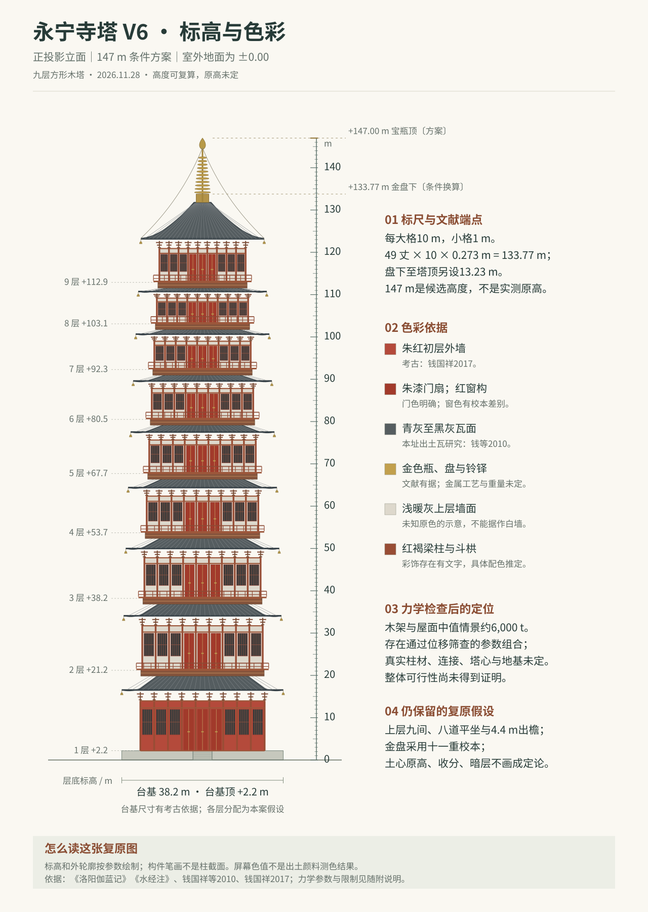
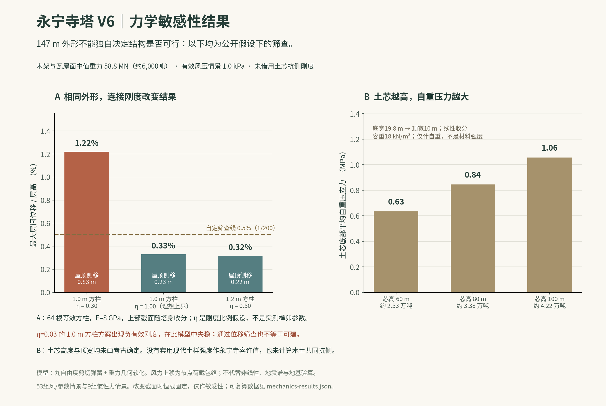

# 永宁寺塔 V6：高度标尺、力学筛查与色彩核验

日期：2026-11-28。承接 [V5 复原研究](../yongning-reconstruction-survey-20261128/README.md)。

## 本版结论

**已把高度尺、九层层底标高和色彩证据加到可按比例阅读的正投影复原立面。147 米继续作为候选高度；本次力学计算没有证明这座历史建筑按当前画法即可建成。**

计算的实际作用，是找出哪些构造假设会失败、哪些组合值得继续论证。较细、约束不足的柱架会出现屈曲或侧移问题；较大截面与较高整体刚度的组合可以通过本次自定的位移筛查，但仍没有通过完整的节点、木土连接、基础与风震验算。既不能以“木材抗压强”宣布可行，也不能只看147米就宣布不可能。

色彩方面，最稳的组合是**朱漆门、初层朱红外墙、灰至青灰瓦面**。金色塔刹是依文字的视觉取舍；上层墙面红白分区、柱梁斗栱的逐件色序没有得到直接证明。

## 成果

| 文件 | 内容 |
| --- | --- |
| [yongning-v6-scaled-elevation.png](yongning-v6-scaled-elevation.png) · [SVG](yongning-v6-scaled-elevation.svg) | 高度标尺与色彩复原立面；SVG可放大 |
| [mechanics-summary.png](mechanics-summary.png) · [SVG](mechanics-summary.svg) | 刚度敏感性、土芯自重图表 |
| [mechanics-results.json](mechanics-results.json) | 所有计算输入和结果；53组风/参数情景、9组惯性力情景 |
| [lateral-sensitivity.csv](lateral-sensitivity.csv) | 便于筛选的侧向响应表 |
| [calculate_mechanics.py](calculate_mechanics.py) | 可复算主程序；不是实体有限元模型 |
| [colour-evidence.md](colour-evidence.md) · [JSON](colour-evidence.json) | 逐对象色彩考证、校本差异、来源 |
| [mechanics-sources.md](mechanics-sources.md) · [JSON](mechanics-sources.json) | 材料与结构方法的主源、适用边界 |
| [design-parameters.json](design-parameters.json) | 立面参数；考古尺寸与方案尺寸分别标明 |
| [independent-review.md](independent-review.md) | 独立复核结果与剩余限制 |



## 一、标尺量的是什么

零点是室外地面，台基顶为 +2.2 m。右侧每大格10 m、小格1 m，左侧标九层层底。图中外轮廓与竖向标高按参数绘制；斗栱、栏杆和柱的笔画宽度仍是细部示意，不能拿笔画换算承重截面。

| 标高对象 | 本案数值 | 证据性质 |
| --- | ---: | --- |
| 室外地面 | ±0.00 m | 本案坐标零点 |
| 台基顶 | +2.20 m | 依据考古报告的基座高度表值 |
| 第一至第九层层底 | 2.2、21.2、38.2、53.7、67.7、80.5、92.3、103.1、112.9 m | 本案层高分配，非逐层实测 |
| 第九层屋顶峰 | +131.80 m | 本案屋面构形 |
| 金露盘下工作标高 | +133.77 m | 49丈 × 10尺/丈 × 假定0.273 m/尺 |
| 宝瓶顶 | +147.00 m | 在上述端点上再设13.23 m |
| 台基边长 | 38.2 m | 考古表值 |
| 首层塔身宽 | 29.4 m | V5沿用的工作参数 |

《水经注》的端点是“自金露槃下至地四十九丈”，并没有直接给出147米。工作尺、盘组上部增量与各层比例都是公开假设。不能把“盘下”悄悄改成完整塔身顶，也不能在“至地”的数值之外再重复加2.2米台基。[《水经注》卷16](https://zh.wikisource.org/zh-hans/水經注/16)

本版没有用一个力学结果反推唯一原高：相同高度可以有不同截面与节点，较矮的塔也可能因差的连接而失稳。要辨认历史高度，还须回到文献端点、尺制和考古几何。

## 二、力学模型怎样建立

### 2.1 已知遗迹不能代替未知上部结构

考古研究记录基部五圈、124个柱位，内侧土坯包砌的木柱为方柱，个别外圈增柱可判圆柱。柱位数量不等于124根等载、贯通九层的柱子。土芯基部约19.8米见方、残高约3.7米，也不等于已知一座高达数十米的连续刚性核心。[钱国祥2017，第三节](https://www.sohu.com/a/198920371_199807)

因此主计算采用一个明确的**等效木架模型**，不声称复原了原塔的真实柱网：

| 参数 | 主表取值 | 敏感性与边界 |
| --- | --- | --- |
| 等效柱数 | 每层64根 | 另算48、96；都不是实测上层柱数 |
| 等效截面 | 首层1.0 × 1.0 m方柱，上部随塔身宽度同比收分 | 另算0.8、1.2 m；圆柱另列Euler对照 |
| 纵向弹性模量 (E) | 8 GPa | 另算6、12 GPa；不鉴定原塔木种 |
| 每层木架、楼层和围护合成重力 | 6 kN/m² × 该层塔身面积 | 另算4、9；包括折算梁柱墙体，不能再重复加一遍框架重量 |
| 屋面合成重力 | 4 kN/m² × 估算斜屋面面积 | 另算2.5、6；均为假设，不是出土屋盖称重 |
| 屋面面积 | 1.10 ×〔本层外檐宽²－上一层塔身穿越面积〕 | 顶层取完整屋面；避免九个整方屋顶重复计重 |
| 等效净风压 | 1.0 kPa | 另算0.5、2.0；不是洛阳规范基本风压或重现期风速 |
| 实际刚度/理想固定端刚度 (η) | 主比较0.03、0.30、1.00 | 另算0.10、0.50；不是实测榫卯刚度 |
| 自定层间位移筛查线 | 1/200，即0.5% | 用于比较，不是北魏标准、法定合格线或倒塌极限 |

木材的性质受树种、纹理、缺陷、含水率和荷载持续时间影响；现代小清材试验平均值不能直接作古代大构件设计强度。本次因此不拿一个现代抗压数值给全塔盖“合格”结论。[USDA Wood Handbook，第5章](https://research.fs.usda.gov/treesearch/62244)

### 2.2 重量与风的数量级

九层塔身投影面积合计约5,743 m²，扣除上层穿越区后的屋面面积假定约6,089 m²。三档木架与瓦屋面合成重量如下：

| 情景 | 木架与楼层折算荷载 | 屋面折算荷载 | 重力 | 折合质量 |
| --- | ---: | ---: | ---: | ---: |
| 较轻 | 4 kN/m² | 2.5 kN/m² | 38.2 MN | 约3,894吨 |
| 中值 | 6 kN/m² | 4 kN/m² | 58.8 MN | 约5,996吨 |
| 较重 | 9 kN/m² | 6 kN/m² | 88.2 MN | 约8,993吨 |

这些数值是所选折算荷载的结果，不是统计置信区间。**未包括台基和土芯，金属塔刹净重也没有确值**；另在顶部追加0.5/2 MN做重力敏感性。这里约6,000吨不能称为原塔总重。

风采用各层外檐宽乘该层高度的实心包络投影，塔刹单列3米宽包络。以1.0 kPa情景计算，实际包络风剪力约4.47 MN。若每层风合力作用在该条带中点，台基顶以上风弯矩约278 MN·m；计算框架时把各层风力上移到层顶，得到约312 MN·m的较大弯矩包络。塔刹合力按等底弯矩折到屋顶节点，使节点总剪力略增到4.477 MN。两套数值分别保存，没有混称实测荷载。

这种包络没有风洞、阵风时程、局部风吸力或涡激振动信息。它能比较参数，不能承担最终抗风判定。

## 三、柱子：自重压应力与屈曲是两回事

在中值重量、64根等效柱的平均分担基础上，示范性采用2倍重力集中系数，并把全塔一阶风矩按29.4米力臂、迎背风各16根的柱组分担，得到示范性偏载轴力约 **2.50 MN**。这是独立需求假设，并非已求解出的真实最不利柱内力，也不含最终P–Δ压弯组合。

对1.0米方柱，平均截面应力为：

\[
\sigma=N/A=2.50\text{ MN}/1.00\text{ m}^2\approx2.50\text{ MPa}.
\]

这个数说明需要什么量级的承载能力，却不能说明柱已经安全。理想弹性屈曲另按：

\[
N_E=\frac{\pi^2EI}{(KL)^2},\qquad I_\text{方柱}=b^4/12.
\]

**仅假定** (E=8\) GPa、无支撑长度 (L=19\) m、(K=2\)：

| 方柱边长 | 理想Euler临界力 | 与2.50 MN需求比较 |
| --- | ---: | --- |
| 0.8 m | 1.87 MN | 已超过理想分岔上界；该假设组合应排除 |
| 1.0 m | 4.56 MN | 尚未达到理想上界；不能据此免除缺陷、压弯与节点检查 |
| 1.2 m | 9.45 MN | 理想上界较高；其他破坏模式仍未知 |

这里19米是一个**弱约束柱段的试算长度**，不是考古已证的柱净长。V5的首层墙身约11.78米、层间增量19米，真正的柱段与中间约束仍需结构剖面确定。另一组12米长度已经保存在结果表。有效长度系数1或2只是理想边界，不覆盖所有可能的侧移机构。

Euler式适用于理想长柱；材料非线性、初始弯曲、偏心与梁柱共同受力会改变承载力，不能将Euler结果当成安全系数。[USDA第9章，9-13至9-16页](https://research.fs.usda.gov/treesearch/62251)

还必须检查局部横纹承压。例如同为2.50 MN反力，若允许的有效接触压应力**假定**为2 MPa，需要累计有效承压面积约1.25 m²。这个例子只说明节点面积的重要性，没有把2 MPa认定为原塔材料的容许值。

## 四、侧向稳定：本次最有判断力的结果

采用九自由度剪切弹簧模型。台基顶 +2.2 m为固定计算基准，节点在21.2、38.2、53.7、67.7、80.5、92.3、103.1、112.9、131.8 m。节点用于集中楼层荷载；最后18.9米等效段包含顶层墙身、斗栱和屋面，**不是一根已知18.9米木柱**。

每层理想固定端上界刚度、参数刚度与重力几何软化取：

\[
k_{0,i}=\sum 12EI/h_i^3,\qquad k_i=\eta k_{0,i},\qquad
k_{\mathrm{eff},i}=k_i-P_i/h_i.
\]

若 (k_\mathrm{eff}\le0)，该剪切模型失稳，不输出虚假的有限位移。其余情景由层剪力积分与独立刚度矩阵求解交叉核验。模型没有包含土芯抗侧贡献；也没有假定所有真实榫卯等于固定端。



### 4.1 在1.0 kPa风压情景下

| 同一147 m外形的结构假设 | 木构屋顶侧移 | 最大层间位移角 | 本次可说的结论 |
| --- | ---: | ---: | --- |
| 1.0 m方柱，η=0.03 | 不给有限值 | 有负有效刚度 | 在该模型中失稳 |
| 1.0 m方柱，η=0.30 | 约0.83 m | 约1/82 | 超出自定1/200筛查线 |
| 1.0 m方柱，η=1.00 | 约0.23 m | 约1/304 | 仅通过该位移筛查；理想固定端上界 |
| 1.2 m方柱，η=0.50 | 约0.22 m | 约1/315 | 仅通过该位移筛查；不是历史构造证明 |

位移指131.8米木构屋顶计算点，不是147米宝瓶顶的总摆动。η=0.30也不是给榫卯随意定了“30%效率”，而是询问“如果整体只有理想固定端刚度的30%，结果怎样”。

改变柱截面或柱数时，表中合成恒载保持不变，以识别单参数敏感性。真正增加木料会增加重力和惯性，必须重新计重；表内较大截面组合不是可以直接照用的加强设计。

对64根1米等效方柱，中值重力、1.0 kPa风压这组特定假设，首层弹性刚度至少约需 **50.2 MN/m** 才能达到自定1/200筛查线；所有层均满足时，统一η至少约 **0.673**。这是一项可检验的结构需求，**不是认定古塔已经具有的刚度**。

真实榫卯存在接触、嵌压、滑移、拔榫和缝隙影响。循环试验对照的原研究表明，接头损伤会削弱刚度与耗能，不能直接把现代刚接计算代给古塔。[Sha、Wang、Li，2019](https://www.mdpi.com/2076-3417/9/16/3429)

### 4.2 地震不能用抗风结果替代

另加水平惯性静力敏感性：(V=CW)，取 (C=0.05、0.10、0.20)，楼层力按 (W_i(z_i-z_0))分配。**C不是PGA、设防烈度或洛阳设计谱**，也未模拟地震时程、循环退化与土芯惯性。

中间情景C=0.10时，剪力约5.88 MN、弯矩约519 MN·m。1.0米方柱η=0.30模型的最大层间位移角约1/62；理想η=1.00约1/231。到C=0.20，即使η=1.00也超过自定1/200线。位移超过2%的模型结果仅作“大变形风险信号”，不作精确小变形预测。

这不能证明古塔抗震通过或不通过，却足以说明：一组风下较好看的数值不能完成整体可行性论证。

## 五、抗倾覆、土芯与地基

### 5.1 整体“不翻倒”不是完整检查

暂以29.4米支承宽、全部木架重力能整体耦合的刚体假设，1.0 kPa风下恢复矩/倾覆矩约2.77；2.0 kPa时约1.39。**这不是规范安全系数，且只使用一阶风矩**。η=0.30的1米方柱情景还有约32.8 MN·m的重力侧移附加矩，总计约344.8 MN·m；不能把312 MN·m写成含P–Δ的最终底弯矩。

更敏感的是1.0 kPa情景的合力偏心距约5.30米，已超过矩形刚性全接触模型的中核界限 (B/6=4.90\)米。这提示接触重新分配与局部抬离问题。离散柱础与夯土台基并非刚性整板，所以既不能直接给其负土压力，也不能据此断言原塔某柱已经抬起。

相应最简抗滑条件要求摩擦系数约0.076；2.0 kPa时约0.152。真正接触面、有效法向力与柱脚约束未定，此处只列需求。

约6,000吨除以38.2米台基面积得到约40 kPa，**不等于地基承载力验算**；它既漏掉土芯与台基，也掩盖了柱础局压。地下约百米范围的夯土处理更不能当作一块同面积的现代刚性筏板。

### 5.2 土芯增加刚度的同时，也增加很大重量

为避免“取土芯的稳定作用、却不算土芯重量”，本次不把未知塔心计入木架抗侧模型，只独立检查自重。

假定方形土芯从底宽19.8米线性收至顶宽10米，容重18 kN/m³：

\[
V=\frac{H}{3}(b_0^2+b_0b_1+b_1^2),\qquad
W=\gamma V,\qquad \sigma_\text{底}=W/b_0^2.
\]

| 假定芯高 | 土芯质量 | 仅自重底部平均压应力 |
| --- | ---: | ---: |
| 60 m | 约2.53万吨 | 0.634 MPa |
| 80 m | 约3.38万吨 | 0.845 MPa |
| 100 m | 约4.22万吨 | 1.056 MPa |

如果60米高土芯完全不收分，平均自重底压则增至1.08 MPa，质量约4.32万吨。孔洞、分层界面、木柱包砌、地基变形和水分还会改变实际应力。土芯是否帮助外部木架抗侧，取决于连接和接触，不能把其全部重量随意用于稳定上部木架或塔刹。

现代原始试验也说明不能给“土”统一强度：一组特定未稳定夯土试验平均抗压约1.40 MPa，葡萄牙建筑取样的两种土坯平均值约1.06和0.69 MPa。它们不是永宁寺材料值，也不是容许应力；土坯砌体与整体夯土还须区别。[Ávila等2023](https://link.springer.com/article/10.1617/s11527-023-02206-9)；[Parracha等原作者稿，第17页表7](https://research.unl.pt/ws/files/17145015/Parracha_et_al_Leiria_vernacular_earth_buildings_material_charact_LJAH19_manuscript.pdf)

几何上也有一道明确约束：若把19.8米土芯不收分一直画到宽20.4米的顶层，两侧各只剩0.3米，尚未扣墙柱，无法同时宣称保留可通行的绕芯回廊。故塔心原高、收分与终止层必须成为独立方案，不能为了算得稳定就填成一根贯顶实体。

## 六、4.4米出檐也要检查

本案每边4.4米出檐是视觉参数。取屋面4 kN/m²、沿用1.10斜面积系数、示意分担宽29.4/9≈3.27米，以一根独立悬臂作需求筛查，其根部弯矩约139 kN·m、竖向反力约63.2 kN：

| 假定挑梁截面 | 弯曲应力需求 | 理想弹性端挠度 |
| --- | ---: | ---: |
| 0.30 × 0.60 m | 约7.73 MPa | 约15.6 mm |
| 0.40 × 0.80 m | 约3.26 MPa | 约4.9 mm |

这不是断言原塔斗栱由单悬臂组成。实际需要叠栱与挑梁共同传力、横纹局压、抗拔和风吸力；未定义这些构件前，深出檐只能保留为待验证外观。

## 七、文献能确认哪些色彩

| 构件 | 本版采用 | 直接依据与不能越过的边界 |
| --- | --- | --- |
| 塔门 | 朱红漆门 | “户皆朱漆/并皆朱漆”都支持门色；不能由“朱”断定颜料化学式 |
| 窗构 | 红色 | 与“并皆”本相容；“户皆”本只明确门，因此保留版本条件 |
| 初层外墙 | 朱红 | 钱国祥2017明确记录初层前檐墙外皮涂朱；不可推广为九层全红 |
| 瓦 | 青灰、黑灰 | 永宁寺出土磨研板瓦、筒瓦研究支持此色域；样本来自塔基与门址，不能逐层分配 |
| 宝瓶、金盘、铃铎 | 金色观感 | 古籍金属名称支持文字导向的画法；纯金、鎏金、贴金或包金工艺尚未定 |
| 四道牵刹链 | 暗铁色 | 文献明确铁锁；原防护涂层与尺寸未定 |
| 上层墙面 | 浅暖灰示意 | 未知原色占位，不作为白墙定论 |
| 梁柱斗栱 | 红褐示意，局部金色门饰 | “绣柱金铺”不提供每件构件的完整配色与纹样 |

文字来源按对象核对：[《洛阳伽蓝记》卷一](https://zh.wikisource.org/zh-hans/洛陽伽藍記/卷一)；[周祖谟校释](https://deerpark.app/cbeta/B0077/1)；[范祥雍校注](https://deerpark.app/cbeta/B0078/1)。

**本版新增的较强屋瓦证据**是钱国祥、郭晓涛、肖淮雁《北魏洛陽城出土瓦の考古学的観察》，奈文研《古代東アジアの造瓦技術》，2010，208–227页；永宁寺段212–214页。已下载原PDF并直接查看212、213页，确认板瓦外面青灰、内面黑灰及磨研光泽等描述。[机构书目](https://repository.nabunken.go.jp/dspace/handle/11177/997)；[原PDF](https://repository.nabunken.go.jp/dspace/bitstream/11177/997/1/BB04047812_208_227.pdf)

这支持灰色系屋面，但不支持把磨研或陶衣写成亮蓝、亮绿琉璃釉。图中色值只是显示选择，不是出土样本测色。

两处必须避免的对象错用：

- “雕梁粉壁，青璅绮疏”紧接**僧房楼观**，不能用来证明塔上层白墙。
- 云气、仙灵、青琐及金银珠玉守护像的描述属于**寺门段**，不能整套移植到塔身。

图中金色也没有用于计算“实心黄金重量”。文献色彩词不能替代金属成分、壁厚与构造调查。

## 八、因此怎样评价这次复原

可以保留：方形九层总体、基座尺寸、公开的147米候选标高、朱红初层与门扇、灰色系瓦面、文字导向的金色刹饰。

已经能排除：将全部构造视作无约束细长柱架仍当然安全；把124基部柱位均载贯通；把等截面19.8米塔心塞满顶层后仍声称宽敞回廊；以及只用总重和抗倾覆比宣告整塔可行。

**还不能确认的，是历史上的147米整塔确实采用了本案所需的截面、抗侧刚度和节点。** 本次有些参数组合仅通过位移筛查，不能升级为建筑整体可建证明。原塔自身曾经存在，与这张复原的每个构造选择正确，是两个不同命题。

要跨过这个证据缺口，必须具体化各圈柱网与截面、真实柱段约束、榫卯和斗栱接触、木土连接、核心逐层几何、柱础与地基，并给出场地风震输入及施工阶段。缺参没有通过增加模型网格数量被消除，因此本版没有用外观模型包装“有限元已验证”的说法。

## 九、复算与版本边界

`calculate_mechanics.py` 使用Python 3与NumPy；`plot_mechanics.py` 使用Matplotlib与Noto CJK字体；`draw_scaled_elevation.py` 用标准库生成SVG。PNG由Sharp/librsvg渲染。复算命令：

```sh
python research/yongning-structure-colour-v6-20261128/calculate_mechanics.py
python research/yongning-structure-colour-v6-20261128/draw_scaled_elevation.py
python research/yongning-structure-colour-v6-20261128/plot_mechanics.py
```

本版没有重新生成V5透视效果图，也没有把透视画面硬拉伸成可量测的立面；所交标尺图直接来自既有可编辑立面参数。寺院考古平面、城市投影H、V12首页基线和生产站均未作为本次力学假设而改动。此交付为独立研究候选，整体可行性未确立，相关实施任务继续保留开放状态。

公开保存的是本项目图形、代码、提炼后的证据与来源链接；第三方论文原PDF和照片仅作内部查证，没有随目录重新发布。
